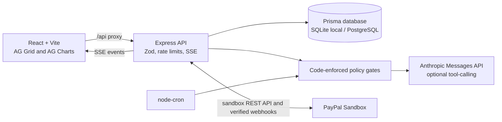

# LicensePilot

AI-assisted licence operations for software vendors: recommend a licence, apply explicit policy gates, route sandbox payments, and keep an auditable renewal pipeline.

**Independent hackathon prototype; not affiliated with or endorsed by AG Grid or PayPal. All payment flows are sandbox-only and use test money.**

## Problem and solution

Developer-software licence purchases and renewals are often handled through spreadsheets and manual follow-up. LicensePilot demonstrates a different workflow: detect paid packages in a project manifest, explain a vendor-defined recommendation, and let an AI agent assist renewal operations while a code-enforced policy engine retains final authority. Checkout uses a clearly labelled **$1.00 sandbox test payment**; that amount is strictly a payment integration test, not a licence price or quote.

The sample AG Grid workflow illustrates a vendor's own rules: online purchase is limited to 1–10 developers using an internal application; external applications or larger teams are routed to sales. Prices are vendor-set; see [AG Grid's pricing configurator](https://www.ag-grid.com/license-pricing/). LicensePilot does not state or infer an AG Grid price.

## Architecture



## Quick start (about 5 minutes)

Requirements: Node.js 20.19+ and npm.

```bash
npm ci
cp .env.example .env
npm run dev
```

Open <http://127.0.0.1:5173>. `npm run dev` prepares the local SQLite database, seeds it only if empty, and starts the API and Vite. With no PayPal credentials, the app clearly uses demo-mode payment simulation. With no Anthropic key, agent assistance falls back to rules and is identified as such.

See [SETUP.md](./SETUP.md) for creating sandbox accounts, configuring credentials locally, and enabling a real sandbox webhook. Do not send credentials in chat or commit `.env`.

## Pages

| Page             | What it does                                                                  |
| ---------------- | ----------------------------------------------------------------------------- |
| Overview         | Start here: what the app does, key numbers, shortcuts                         |
| Customers        | AG Grid customer list; click a company for details and auto-renewal           |
| Licence Advisor  | Paste package.json → licence suggestion → spending-rule check → test payment  |
| Renewals         | Run the renewal autopilot (practice run by default) and edit the safety rules |
| AI Assistant     | Read-only questions about customers (simple rules when no Anthropic key)      |
| Payments         | Every checkout, renewal bill and auto-renewal, labelled test or simulated     |
| Activity History | Audit log of autopilot decisions and PayPal updates, CSV export               |

## Live payment demo

The **Licence Advisor** page runs the buy flow, and the **Payments** page lists every payment and includes a short "Try a full test purchase" walkthrough. In demo mode, the simulated checkout is labelled and saved as demo data. For an actual sandbox checkout, configure the PayPal sandbox client ID and secret and use the PayPal buyer approval flow; the buyer must approve the order. The only approved test charge is **$1.00**, labelled “Sandbox test payment, no real money.” It is not a product price or licence quote.

For invoice and subscription payment updates, configure a webhook ID and expose the local API only after reviewing and approving a public tunnel. PayPal notifications are signature-verified and event IDs are persisted for idempotent processing. External API/tunnel use and public deployment require the operator's own credentials and authorization. The current sandbox integrations have not been independently verified with live credentials in this environment.

Automatic-renewal setup requires recording the customer's opt-in in the customer panel (click a company on the **Customers** page). LicensePilot creates a PayPal approval link only after that opt-in and the policy gates pass; recurring charges start only after the customer approves at PayPal.

## Environment

| Variable                                    | Purpose                                                                 |
| ------------------------------------------- | ----------------------------------------------------------------------- |
| `PAYPAL_CLIENT_ID` / `PAYPAL_CLIENT_SECRET` | PayPal Developer Dashboard sandbox app credentials                      |
| `PAYPAL_WEBHOOK_ID`                         | ID for the sandbox webhook registered to the app                        |
| `ANTHROPIC_API_KEY`                         | Anthropic Console API key; optional, rules-only fallback otherwise      |
| `AI_MODEL`                                  | Anthropic model name; defaults to `claude-sonnet-4-6`                   |
| `DATABASE_URL`                              | Prisma URL; defaults to local SQLite `file:./dev.db`                    |
| `PORT`                                      | Local API port; defaults to `3001`                                      |
| `APP_URL`                                   | App URL used for payment redirects; defaults to `http://127.0.0.1:5173` |

Keep values out of source, logs, screenshots, and commits. Never use live PayPal credentials for this prototype.

## Data and assumptions

The seed creates 500 fictional customers; 7.8% are over their seats and 8.4% have outstanding balances. These are illustrative demo records, not real customer data. Unpaid balances are modest synthetic amounts, distinct from total licence value. Renewal values use an explicitly labelled **30% estimate assumption**, not an official vendor renewal rate. No fixed AG Grid product price is shown. SQLite is the local default; PostgreSQL uses the checked-in Prisma schema and initial migration. Database persistence on free hosting may be ephemeral and records can reset.

## Development and tests

```bash
npm test          # Vitest unit and API tests
npm run lint       # ESLint
npm run format     # Apply Prettier formatting
npm run build      # Production frontend build
npm run test:e2e   # Playwright; starts the app through its configured webServer
```

Automated E2E checkout uses the clearly labelled demo flow only; it skips that payment test when PayPal sandbox credentials are configured to avoid unattended charges. The PayPal and Anthropic calls still need operator-provided credentials for end-to-end sandbox validation.

## Limitations

- The $1.00 amount is only a sandbox integration test, never a licence quote.
- Renewal amount is a 30% estimate assumption and must be confirmed by a vendor.
- Actual PayPal sandbox checkout, invoice payment, subscription renewal, and webhook delivery have not been tested with credentials in this environment.
- Anthropic tool calling has automated policy-gate tests, but real model calls require an operator-provided API key and have not been tested here.
- Email beyond PayPal's invoice delivery, authentication, and production-grade user/tenant isolation are outside this prototype.
- A free hosted service may sleep or lose its local SQLite database; the database is not a durable production store.
- `render.yaml` is a free-only draft, not deployed. The API is deliberately loopback-only here; Render deployment is paused until an externally reachable listener is explicitly authorized.

## AI tools used

- Anthropic Claude via the Messages API is the optional runtime agent for recommendations, vendor questions, and renewal decisions.
- AI-assisted software development tools were used during implementation.

## Independence and sandbox disclaimer

LicensePilot is an independent hackathon prototype. AG Grid and PayPal names are used only to describe the example integration; this project is not affiliated with, endorsed by, or sponsored by either company. All PayPal transactions are sandbox test money. No real payments are processed.

## Licence

MIT. See [LICENSE](./LICENSE).
