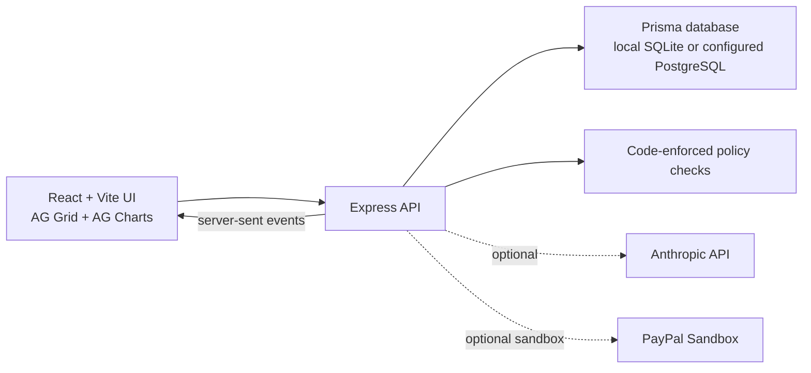

# LicensePilot product demo — timed storyboard

**Runtime:** exactly 03:00 (180 seconds)
**Format:** 1920×1080, 16:9, 25 fps
**Audience:** AG Grid product, licensing, sales, and operations stakeholders
**Positioning:** independent hackathon prototype; fictional seeded records; demo/sandbox only

## Persistent disclosure

Keep a small, readable lower-third throughout the UI walkthrough (or at least at each scene opening): **Independent prototype · fictional data · sandbox/demo only**. Use a neutral translucent background and sufficient contrast. Do not cover the app’s own Demo/Simulated/Rules-only labels.

## Edit timeline

| Time | Duration | Picture and action | Narration |
|---|---:|---|---|
| 00:00–00:15 | 15s | Begin with the actual Overview, then move through sample metrics, attention list, renewal stages, and regional AG Charts view. Keep the fictional-data disclosure visible. |
| 00:15–00:35 | 20s | Hold on the Overview data and move the pointer deliberately across the metrics and chart. |
| 00:35–01:08 | 33s | Open Licence Advisor. Show the prefilled manifest with `ag-grid-enterprise` and `ag-charts-enterprise`; point to developer count and internal/external audience. Show the illustrative route, spending-policy step, $1.00 sandbox integration test label, and existing-project comparison. Do not submit or complete a payment. |
| 01:08–01:34 | 26s | Open Customers. Show the real AG Grid table, search/filter, seat and developer counts, renewal timing, account status, a customer detail panel, and CSV export. Do not send a bill. |
| 01:34–02:06 | 32s | Open Renewals with **Practice run (dry run)** checked. Run once against the temporary local demo data, show the “no bills sent” confirmation and decisions, and reveal the code-enforced policy controls. Mention the daily schedule without implying it ran. |
| 02:06–02:22 | 16s | Open AI Assistant, ask “Which customers renew this month?” and show the Rules badge and limited rules-based answer. |
| 02:22–02:40 | 18s | Show Payments with the Simulated source label, then Activity History filters and a decision reason. |
| 02:40–02:55 | 15s | Show the architecture card: React/Vite, AG Grid/Charts, Express, Prisma, code policy, optional Anthropic, PayPal sandbox, and demo simulation. |
| 02:55–03:00 | 5s | End on the disclosure card and the explicit statement that the prototype is not affiliated with or endorsed by AG Grid or PayPal. |

## Architecture card

Label the card **“Prototype architecture”**. Do not imply the app is deployed, production-ready, or verified with live credentials.

## Accuracy and edit checks

- The AG Grid licensing routes are illustrative rules in this prototype. State that current real terms must be confirmed with AG Grid; do not present them as definitive policy.
- Do not show or infer an AG Grid product price. The app’s $1.00 value is solely a sandbox integration test, not a quote or licence price.
- All customer records and dashboard totals are fictional seeded demo data.
- Payments may be simulated locally or use PayPal sandbox, depending on configuration. Report only the source label visible in the app. Never use production services or credentials.
- The assistant is optional at runtime. With no Anthropic key, the app visibly labels its limited fixed-rules fallback. Claude in VS Code is separate from this runtime integration.
- Keep renewal practice mode checked; never send invoices, create subscriptions, or complete checkout during recording.
- Keep UI text large enough to read. Prefer steady cursor motion and direct cuts or short dissolves; no rapid zooms, fake UI, or busy transitions.
- The narration is spoken voiceover with no burned-in subtitles. Keep all nine scene boundaries and the total 180-second runtime exact.
